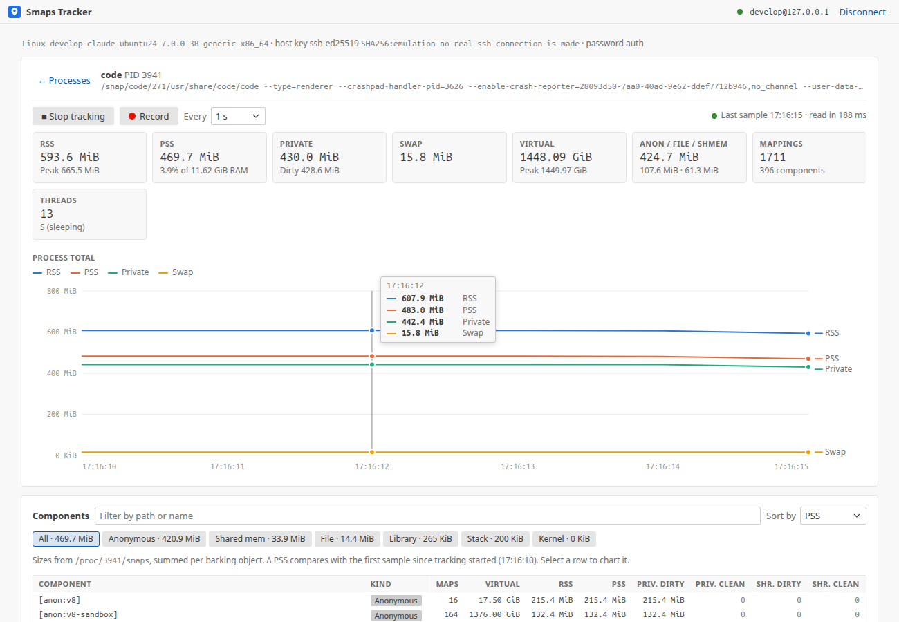

# Smaps Tracker

A TypeScript + React web UI, served by a libnetq WLA module, that tracks the
memory of a process on a **remote Linux host over SSH**:

1. enter the host's IP address, port, user and a password or private key —
   or pick one of the **recent connections** (the last 10 that succeeded,
   kept in this browser's localStorage; passwords and keys are never stored);
2. pick a process from the remote process list;
3. watch its memory live — totals and **every component** (each shared
   library, file mapping, `[heap]`, `[stack]`, named and plain anonymous
   memory, shared memory) summed from `/proc/<pid>/smaps`, next to
   `/proc/<pid>/status` and the host's `/proc/meminfo`;
4. **Record** a span of samples and download it as a single-file HTML report,
   CSV or JSON.

Nothing is installed on the target: `module.c` opens the SSH session with
libssh2 and runs plain POSIX `sh` commands (`cat`, `tr`), so busybox targets
work too. Reading another user's process needs that user or root, as with
`cat /proc/<pid>/smaps` itself.



```
smapstrack-wla/
├── module.c        WLA module: SSH sessions (libssh2) + the JSON API
├── server.c        standalone server that loads the module
├── src/            client source (TypeScript + React)
├── public/         static assets copied verbatim into dist/ (favicon.svg, logo_wla.svg)
├── docs/           README assets (screenshot.png)
├── index.html      Vite entry HTML
├── dist/           BUILD OUTPUT — client files + manifest.json (see below)
├── server/         emulation server (plain JS, Node built-ins only)
│   └── server.js
├── bitmake.config.mjs   native dependency build (openssl, libssh2, libnetq, …)
├── vite.config.ts
└── package.json    all deps in devDependencies
```

## Build the real server

```bash
npm install
npm run bitmake      # builds every bundle, then this project, into build/package
npm run server       # build/package/bin/smapstrack_server on http://localhost:8033
```

`bitmake.config.mjs` builds libssh2 statically against the bundled OpenSSL
(position-independent, since it is linked into the `smapstrack_wla` shared
module); `CMakeLists.txt` finds it through libssh2's own package config.

## Develop the UI (two terminals)

```bash
npm run emulation    # emulation API on http://localhost:3001
npm run dev          # Vite UI on http://localhost:5173 (proxies /api → :3001)
```

The emulation server answers the same API without SSH: `connect` accepts any
host that resolves to an IPv4 address and any credentials, and every session reads the **local** machine's
`/proc`, so the UI shows real data on a Linux dev box. Its parsing follows
`module.c`, so the JSON has the same shape.

`npm run start` builds the client and serves it from the emulation server.

## Build output

`npm run build` emits **only client files** into `dist/`:

| file            | source                                  |
| --------------- | --------------------------------------- |
| `index.html`    | `index.html` (processed by Vite)        |
| `app.js`        | bundled `src/**` + React                |
| `app.css`       | bundled `src/styles.css`                |
| `favicon.svg`   | `public/favicon.svg` (copied verbatim)  |
| `logo_wla.svg`  | `public/logo_wla.svg` (copied verbatim) |
| `manifest.json` | generated by `vite.config.ts`           |

### Base URL

To serve the app under a sub-path, put `baseUrl` in a JSON file and pass it
with `--config` (before any `--`, so npm keeps it as config instead of handing
it to Vite, which has a `--config` option of its own):

```bash
npm run build --config=path/to/config.json
```

```json
{ "name": "smapstrack-wla", "version": "1.0.1", "baseUrl": "/123" }
```

`name` and `version` must match `package.json`, or the build stops with an
error; CMake fills them from `project()` in `CMakeLists.txt`.

### Fixed endpoint

A non-empty `endpoint` in the same file fixes the SSH target: there is no
connect form, the app connects by itself (as the user given, with no password
or key, so the account must allow that) and opens on the process list. Until
a connection succeeds the list stays blocked and the attempt is repeated every
5 s; a lost session is reconnected the same way. CMake fills it from
`SMAPSTRACK_ENDPOINT`:

| `endpoint`              | connects to                                   |
| ----------------------- | --------------------------------------------- |
| `root@192.168.1.1:5600` | `192.168.1.1`, port 5600, as `root`           |
| `develop@192.168.1.1`   | `192.168.1.1`, port 22                        |
| `develop@0.0.0.0:4555`  | the hostname the page was loaded from, 4555   |

The host is an IPv4 address or a name (`develop@device.local`), which the
server resolves to an IPv4 address; a malformed value fails the build. Empty
leaves the form free to edit.

CMake does this itself: it writes `config.json` from `config.json.in` with
`SMAPSTRACK_BASE_URL`, the same value `module.c` is compiled with, so the client
and the module always agree. With `"baseUrl": "/123"`:

- the page is served at exactly `/123` (the value as given — no trailing slash
  is added), and the header's title links there;
- assets live under `/123/` (`/123/app.js`, `/123/favicon.svg`, …);
- the client calls the API at `/123/api`, matching `SMAPSTRACK_API_URL`;
- a **Home** link to the site root appears in the header.

Without a `baseUrl` the build is relative: it works from any path, and the API
is called at `./api`.

### `manifest.json`

`dist/manifest.json` describes the module to libnetq's WebManifest executor and
to the host's main page. It is regenerated on every build, and every URL in it
is final, already prefixed with the base URL:

- `entries[0].main` and the `index.html` entry in `files` are always the same
  URL — the page's address (`/123`);
- `icons` points at `favicon.svg`;
- `screenshots` points at `logo_wla.svg`, the card the main page presents the
  module with (for both light and dark color schemes);
- `files` lists every file in `dist/` with the URL it is served on.

## JSON API

A single endpoint, `POST <base-url>api`; the body's `method` picks the
operation. Shapes are in `src/types.ts`; sizes are kB, as the kernel prints
them. Errors are `{ "error": "..." }` with an HTTP status: `404` when the
session is gone (idle for 15 minutes, transport failure, server restart —
the client returns to the connect form), `412` when the remote command
failed (process exited, permission denied), `401` for failed authentication,
`502` when the host could not be reached.

### `connect`

```jsonc
// request — private_key (PEM/OpenSSH text) takes precedence over password
{ "method": "connect", "host": "192.168.1.10", "port": 22, "user": "root", "password": "…" }
// response
{
  "session": "6f1c…",                // id for the other methods
  "host": "192.168.1.10", "port": 22, "user": "root",
  "auth_method": "password",         // publickey | password | keyboard-interactive
  "hostkey_type": "ssh-ed25519",
  "fingerprint": "SHA256:…",
  "banner": "SSH-2.0-OpenSSH_9.6",
  "uname": "Linux box 6.8.0 x86_64",
  "libssh2_version": "1.11.1"
}
```

The host key is not checked against a `known_hosts` file; its fingerprint is
returned, and shown when hovering the connection in the header, so it can be compared. `host` is an IPv4 address or a
name, resolved with libnetq's `NQGetAddrInfo` to the first IPv4 address; the
lookup blocks and is not covered by the connect timeout. At most 16 sessions are open at once.

### `processes`

`{ "method": "processes", "session": "…" }` → `{ "time", "processes": [...] }`,
each with `pid`, `ppid`, `name`, `state`, `uid`, `user`, `threads`,
`rss_kb`, `swap_kb`, `cmdline` and `kernel_thread`.

### `sample`

`{ "method": "sample", "session": "…", "pid": 1234 }` reads
`/proc/1234/status`, `/proc/1234/smaps` and `/proc/meminfo` in one round trip:

```jsonc
{
  "pid": 1234, "time": 1761140000000, "name": "nginx", "state": "S (sleeping)",
  "elapsed_ms": 42,
  "fields": ["size", "rss", "pss", "private_dirty", "swap", "…"],  // what this kernel reports
  "totals": { "count": 312, "size": 98304, "rss": 20480, "pss": 9000, "…": 0 },
  "components": [
    { "name": "[heap]", "kind": "heap", "count": 1, "rss": 4096, "pss": 4096, "…": 0 },
    { "name": "/usr/lib/libc.so.6", "kind": "library", "count": 5, "…": 0 }
  ],
  "status": { "VmRSS": 20480, "VmHWM": 24000, "VmSwap": 0, "RssAnon": 6000, "Threads": 4, "…": 0 },
  "meminfo": { "MemTotal": 16318000, "MemAvailable": 9000000, "…": 0 }
}
```

`kind` is one of `heap`, `stack`, `anon`, `library`, `file`, `shmem`,
`kernel`, `other`.

### `disconnect`

`{ "method": "disconnect", "session": "…" }` → `{ "closed": true }`.

## Term explanations

In the legends of the Process total and Component charts, hovering (or keyboard-focusing) RSS, PSS, Private or
Swap shows what it means and which `/proc` field it comes from. The texts
live in one place, `src/lib/glossary.ts`; the HTML report embeds the same
table, so its chart tooltips match the app's.

## Tracking and recording

**Start tracking** polls `sample` at the chosen interval (0.5–30 s), waiting
for each answer before scheduling the next; the live chart keeps the last 900
samples. **Record** starts a recording (and tracking, if it was off); **Stop
recording** keeps it in the page under **Recordings**, where it can be viewed
again or downloaded:

- **HTML** — one self-contained report file (styles, script and data inline,
  no network access needed to open it): a start/end/min/peak summary, the
  totals chart with a hover readout, and a sortable, filterable component
  table whose rows chart that component. It is built in the browser by
  `src/lib/report.ts` from `src/report/report.js` and `report.css`; the data
  is stored column-wise, about 16 KB per sample for a process with ~400
  components, so an hour at 1 s is tens of MB;
- **CSV** — one row per sample and component plus a `[total]` row per
  sample, every smaps field as a `<field>_kb` column;
- **JSON** — the samples exactly as the API returned them.

**Clear** drops the live chart — its samples and markers — so it starts
again from blank (Δ PSS then compares with the first new sample); tracking,
if on, carries on. Recordings, including one in progress, keep their own
samples and markers.

**Markers** are notes ("load test started") that you place yourself: click
a point on either chart (or focus the chart, pick a point with ←/→ and press
Enter), type the note and press Enter. The marker is attached to the sample
closest to where you clicked — one per sample; clicking a marked sample edits
its note or removes it. Each one is drawn on both charts as a dashed line with
its label on top (labels stack in up to three rows; the full text is in the
hover readout), and listed as a chip with a × to remove it. Markers work in
the live view and on a recording under review; those on a recording's samples
belong to it and are kept in every export: the HTML report draws them and
lists them under the summary, the CSV has them as `[marker]` rows with the
text in a `note` column, and the JSON as a `markers` array.

Recordings live in the browser tab only; download them before closing it.
